# Quantimation: production art bible v1

**Owner:** Percival (art direction) · **For:** the renderer/rig coding agent · **Repo audited:** `wckdboy/Quantimation` @ `898a498` (29 Oct 2026, 00:00 UTC+1)
**Files:** `palettes.json` (every number in this document, machine-readable) · `mouth-visemes.dot.json` (drop-in mouth variants that pass the validator) · `src/line-engine.mjs` (reference taper/wobble stroke code that generated the SVGs) · `images/`

> The look: a loose, adult-sitcom TV style. Thin near-black lines, flat colour, wobbly goggle eyes, dry suburban sci-fi. **The style is fair game, but the IP is not.** Every character, place and prop in this bible is original. Numbers beat adjectives, and every rule says where it lands in the code.

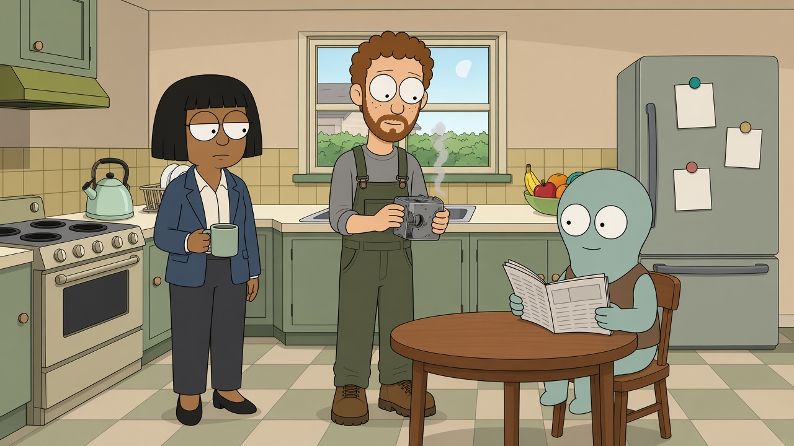
*Style frame (mood, not a model sheet). Dot, Teo and Gloam in Dot's kitchen.*

---

## 0. Brutal audit of what's there now

I rendered the bundled projects headless through the real `src/renderer.js` (`images/current/`).

| Current frame | What I see |
|---|---|
|  | **IP problem first.** Dr. Oona Quark has a spiky silver crest, a lab coat over a teal shirt and drooly teeth. She's a reckless scientist grandparent with a reluctant grandson assistant (Pip). That's a gender-swapped near-copy of the show's lead duo in silhouette, costume *and* premise. **Retire Oona/Pip or redesign them from scratch.** The `portal` standard (`src/standards.js:91`, a green-ringed swirl aperture) is the show's signature device. Rename and redesign it, or drop it. Craft problems: the arm visibly detaches at the shoulder (no joint overlap), the hand floats, line weight is the same everywhere, and nothing anchors the figure in a space. |
|  | The dragon is the better asset. But the background is inked as heavily as the character (4 px ink on houses), so it competes with him. Values aren't separated, and the drawing has no shadow side. |

Why the output reads as "puppet":
1. **Everything moves all the time.** Arms idle on `sin(t*2)*3` (`renderer.js:76`), the head sways on `sin(t*2)*1.8` (`:78`), the head bobs on `talk*sin(t*9)*3.5` while speaking (`:82`), and the arms flap on `talk*sin(t*5)*9` (`:93`). It's a sine wave on every joint and never holds.
2. **Every character blinks on the same frame**, every 3.70 s, because the trigger is `sin(t*1.7+0.3) > 0.995` on *scene* time (`:108`).
3. **Animation runs at the export rate** (`captureStream(30)`, `app.js:696`), so every frame shows a new pose. Nothing is on 2s, and the motion looks like interpolated rubber.
4. **Lines have no life.** Most character art is `path`, and paths never wobble. Only `ellipse` and no-radius `rect` get `roughEllipse`/`roughRect`, and that wobble scales with radius (1.8% of r), so big shapes wobble more. There's no taper, and widths scale with zoom.
5. **Fake turnarounds.** The profile is `ctx.scale(0.7,1)` (`:280`) and the three-quarter is a skew. The camera's `low`/`high` "perspective" shears the whole drawing (`:231–232`).
6. **The mouth is a text-letter guess** (`pose.js:33`). It changes every frame and isn't phoneme-aligned.
7. **The export is real-time MediaRecorder at 1280×720**, so dropped frames are possible and the result isn't deterministic.

None of this needs a new engine. It needs rules, plus about 8 targeted changes (§10).

---

## 1. Line rules

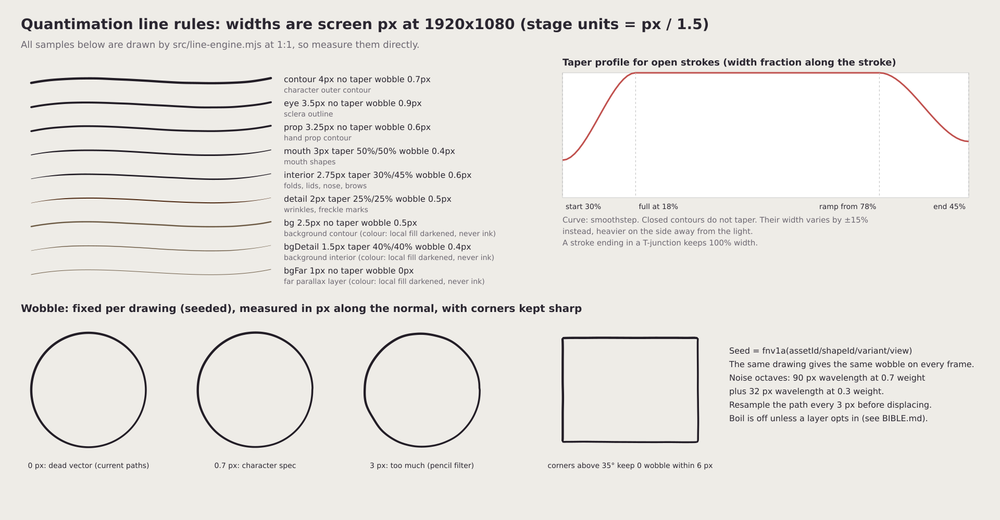
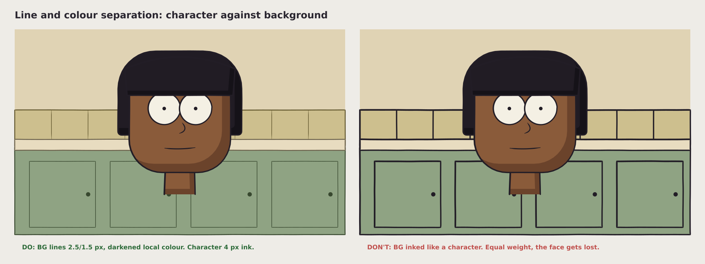

Widths are **screen px at 1920×1080**. Stage units on the repo's 1280×720 stage = px ÷ 1.5. JSON key: `line.classes`.

| Class | Use | px @1080 | stage | Taper start/end | Wobble px | Colour |
|---|---|---|---|---|---|---|
| `contour` | character outer silhouette | **4.0** | 2.667 | none, ±15% weight modulation (shadow side heavier) | 0.7 | ink `#221D26` |
| `eye` | sclera outline | **3.5** | 2.333 | none (±10%) | 0.9 | ink |
| `prop` | hand props | 3.25 | 2.167 | none (±10%) | 0.6 | ink |
| `mouth` | mouth outline | 3.0 | 2.0 | 50% / 50% | 0.4 | ink |
| `interior` | folds, lids, nose, brows, collar | **2.75** | 1.833 | 30% / 45% | 0.6 | ink |
| `detail` | wrinkles, cheek marks, freckle ticks | 2.0 | 1.333 | 25% / 25% | 0.5 | local **shadow** colour darkened (L×0.75) |
| `bg` | background contours | **2.5** | 1.667 | none | 0.5 | local fill darkened: OKLCH L×0.55, C×0.9 |
| `bgDetail` | BG interior lines | 1.5 | 1.0 | 40% / 40% | 0.4 | same as `bg` |
| `bgFar` | far parallax layer | 1.0 | 0.667 | none | 0 | OKLCH L×0.75 |
| `fx` | fire, smoke, energy | 0 (no line) | 0 | n/a | boil 0.8 | none |
| `none` | shadow shapes, colour holds | 0 | 0 | n/a | n/a | n/a |

**Taper (open strokes only).** Width starts at 30% and ramps with smoothstep to 100% by 18% of the stroke length. It holds at 100%, then ramps down over the last 22% to an end width of 45%. A stroke ending in a T-junction against another line ends at **100%** so the joint never opens. Closed contours never taper. Their width varies by ±15% with `1 + mod·dot(normal, lightAway)`, so the side away from the key light reads heavier. (Implementation: `strokeOutline()` in `src/line-engine.mjs`.)

**Wobble.** Displace along the normal by `A · (0.7·n(s/90) + 0.3·n(s/32))`, where `s` is arc length in px and `n` is smooth 1D value noise in [−1, 1]. Resample the path every 3 px first. Corners above 35° get zero wobble within 6 px, so boxes keep crisp corners. **Seed** = `fnv1a(assetId/shapeId/variant/view)`. The wobble is fixed per drawing and **never a function of time**. A held drawing must be pixel-identical frame to frame.

**Boil.** Default is **OFF** for characters, props and backgrounds. The show style doesn't boil, and boil on a puppet rig just looks like jitter.
- `fx` boils at 0.8 px amplitude with 3 seeds, each held 2 frames (smoke is held 3 frames).
- Optional `movingHold` boil, characters only: 0.35 px, 3 seeds on 3s, only for holds of 48 frames or more.
- Never boil: a speaking close-up, any frame with a camera move in progress, pupils, backgrounds, props at rest.

**Screen-space width.** Width is specified on screen, not in asset space. Compute `localWidth = specPx / (instanceScale·zoom) · clamp(instanceScale·zoom, 0.8, 1.25)`. Lines may grow up to 25% in close-ups and shrink to 80% in wides, but never scale proportionally. Minimum on screen is 1.25 px, to avoid shimmer.

**Character vs background.** Characters use ink at 4.0/2.75. Backgrounds use the darkened local colour at 2.5/1.5 and **never ink**. This weight-and-colour gap alone does most of the work of making characters "pop".

---

## 2. Colour model

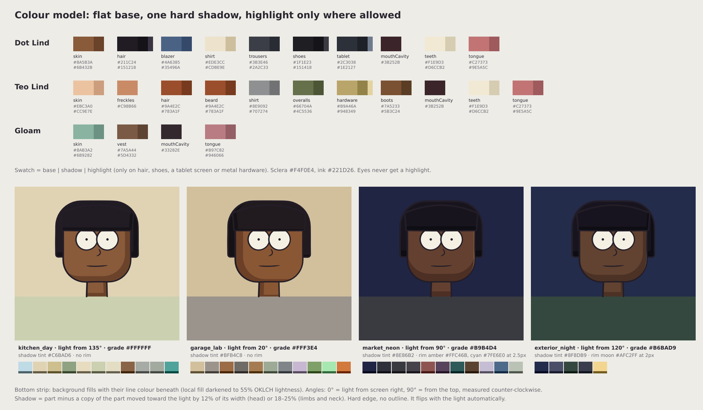

- **Fills are flat.** No gradients on characters, ever. Backgrounds can use a single soft light pool only around emissive sources (lamps, jars), with a radius of 60–160 px.
- **One shadow tone per material.** It's hand-picked: every character part in `palettes.json → characters.*.parts.*.shadow` has one. If a part lacks a picked value, use `shadow = base × scene.shadowTint` (multiply). Shadows have a hard edge and **no outline**.
- **Shadow geometry by offset mask (default).** `shadow = part − (part translated toward the light by k·partWidth)`. Use k = 0.12 for heads and torsos and 0.18–0.25 for limbs and necks. The light comes from `scene.lightAngleDeg` (0° = screen right, 90° = top, counter-clockwise). Because it's computed, it **flips correctly when an instance is flipped or the scene light changes**. Hand-authored shadow shapes (`line:"none"`, `shadow:true`) override it for faces in key close-ups. Canvas recipe: fill the part with base → `save(); clip(part); fill(bigRect + translatedPart, "evenodd")` with the shadow colour → `restore()`.
- **Highlight: one shape, only where allowed.** Allowed on Dot's hair (one band), shoes, the tablet screen, metal hardware (Teo's overall buckles), and glass or wet props. Size ≤ 8% of the part's area, colour = `parts.*.highlight`. **Eyes never get a highlight.** The goggle-eye convention is a pure sclera with a dot.
- **Rim light: neon and night scenes only.** It's a 2.5 px band (2.0 px at night) on the side facing a visible coloured source. Recipe: `clip(part); fill(bigRect + part translated AWAY from the source by rimWidth, evenodd)` with the rim colour. Never use it in daylight.
- **Scene grade.** Characters keep their model colours but are multiplied by `scene.characterGrade`. Pre-multiplied values are in `scenes.*.gradedCharacters`. Never recolour a character into a monochrome blue: night is a multiply grade plus a deeper shadow tint, not a hue swap.
- **Contact shadow.** A flat ellipse 1.1× the foot span wide and 8 px tall, coloured `scene.contactShadow`, with no alpha blur. It replaces the hard-coded `#18233130` at `renderer.js:268`.

**Building palettes for new characters.** Pick 1 dominant hue (≥ 50% of the silhouette area), 1 secondary and at most 1 accent. Keep character fills at OKLCH chroma ≤ 0.15 and background fills ≤ 0.08. Only emissives exceed 0.12, and accents may break the cap if they cover ≤ 3% of the frame. Make each shadow by hand: OKLCH L −0.10 to −0.14, chroma ×1.0–1.1, hue shifted 5–10° toward 280 (cool). Skin shadows shift toward red-violet, not grey.

**Scene palettes** (full lists, line colours and graded character colours are in `palettes.json → scenes`):

| Scene | Type | Light | Shadow tint | Char grade | Rim | Key BG hexes |
|---|---|---|---|---|---|---|
| `kitchen_day` | day | 135° (window, upper left) | `#C6BAD6` | `#FFFFFF` | none | wall `#E0D3B4`, cabinet `#8FA383`, counter `#E8DCC0`, floor `#CBD0B0`/`#E3DDC4`, sky `#BFDCE6` |
| `garage_lab` | late afternoon | 20° (open door, right) | `#BFB4C8` | `#FFF3E4` | none | wall `#D2BF9C`, concrete `#9A948C`, bench `#9C6C46`, fridge `#9DAA95`, porthole (emissive) `#A6E8B0` |
| `market_neon` | alien neon | 90° (overhead jars) | `#8E86B2` | `#B9B4D4` | amber `#FFC46B` / cyan `#7FE6E0`, 2.5 px | sky `#1F2542`, floor `#3A3A41`/`#46434B`, awnings `#8E5550` `#58435C` `#2F5A5A` |
| `exterior_night` | night | 120° (moon) | `#8F8DB9` | `#B6BAD9` | moon `#AFC2FF`, 2 px | sky `#232C4A`, houses `#4A4E66`, lawn `#34483F`, lit window (emissive) `#F2D58F` |

**Value separation rule (testable).** Take the mean L\* of a character's silhouette and compare it with the mean L\* of the background pixels inside the silhouette's bbox grown by 50%. The difference must be **≥ 12**. If it fails, darken or lighten that part of the background. Never brighten the character.

---

## 3. Character construction

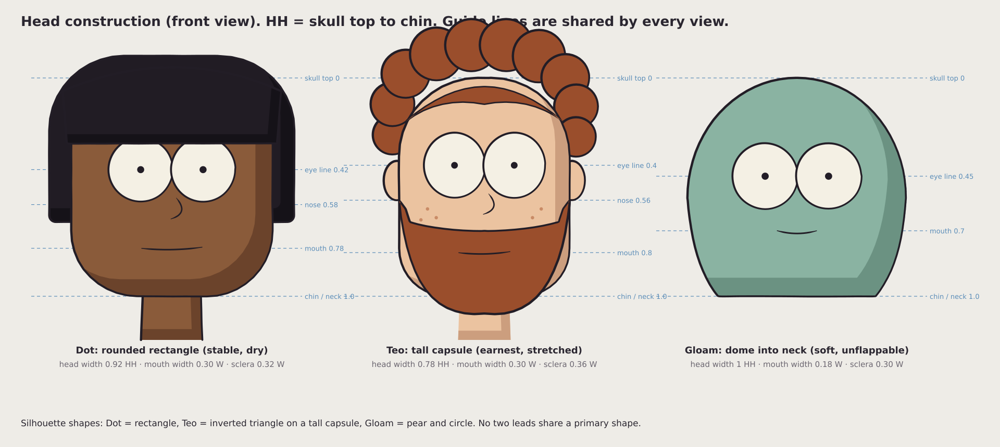
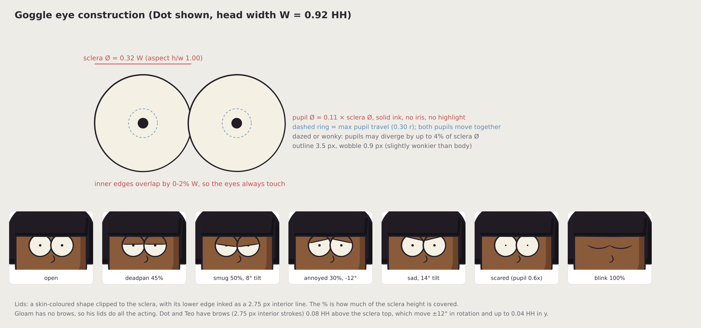
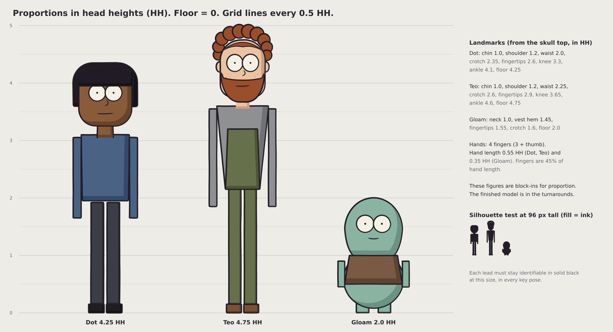

**Units.** HH = head height, measured from skull top to chin (hair excluded). W = skull width.

**Head primitives.** Each lead gets one primitive, and no two leads share one.
- **Dot:** rounded rectangle, W = 0.92 HH, top corner radius 0.20, jaw radius 0.30.
- **Teo:** tall capsule, W = 0.78 HH, top radius 0.36, jaw radius 0.22, with a beard mass from 0.56 HH to the chin plus 0.08.
- **Gloam:** a dome (semi-ellipse, rx 0.5, ry 0.55) that narrows to a neck of ±0.36 at 1.0 HH and widens again into a pear body.

**Goggle eyes** (`palettes.json → eyes`):
- **Sclera:** a circle `#F4F0E4`, 0.32 W across (Dot), 0.36 W (Teo) or 0.30 W (Gloam). Aspect h/w is 1.00 (Teo 1.06).
- **Spacing:** the inner edges always touch, overlapping by 0–2% of W.
- **Eye line:** 0.42 HH (Dot), 0.40 (Teo), 0.45 (Gloam). Dot's sclera tops tuck up to 4% under her fringe, and the fringe is drawn over the eyes.
- **Pupil:** a solid ink dot 0.11 × the sclera diameter, at least 4 px on screen. No iris, no highlight.
- **Look direction:** pupils travel up to 0.30 × the sclera radius, and both move together. A dazed or wonky look can diverge by up to 4% of the sclera diameter. Scared shrinks the pupils to 0.6×.
- **The goggle convention:** the sclera outline wobbles at 0.9 px, more than the body, which gives the slightly hand-made "goggle" feel.
- **Lids:** a skin-coloured shape clipped to the sclera, with a 2.75 px inked edge. Coverage: deadpan 45%, smug 50% with an 8° tilt, annoyed 30% at −12° (inner corners down), sad at 14° (outer corners down), blink 100%. When closed, the eye is drawn as a single curved lid line (the sclera outline is hidden).
- **Brows:** Dot and Teo have 2.75 px interior strokes 0.08 HH above the sclera top, which rotate ±12° and move up to 0.04 HH in y. Gloam has no brows, so his lids do all the acting.

**Nose and mouth.**
- The nose is a single 2.75 px "c" stroke at 0.58 HH (Dot) or 0.56 HH (Teo). Gloam has none.
- The mouth centre sits at 0.78 HH (Dot), 0.80 (Teo) or 0.70 (Gloam). Neutral width is 0.30 W (Gloam 0.18 W).
- In three-quarter view the mouth shifts 12% of W toward the far side. In profile it sits 0.10 W behind the front contour.

**Proportions.**
- **Dot, 4.25 HH:** shoulder 1.2, waist 2.0, crotch 2.35, fingertips 2.6, knee 3.3, ankle 4.1.
- **Teo, 4.75 HH:** shoulder 1.2, waist 2.25, crotch 2.6, fingertips 2.9, knee 3.65, ankle 4.6.
- **Gloam, 2.0 HH:** neck 1.0, vest hem 1.45, fingertips 1.55, crotch 1.6.

**Hands.** Four fingers (three plus a thumb). Hand length is 0.55 HH (Gloam 0.35), and fingers are 45% of the hand length. Hand variants: `relaxed`, `point`, `fist`, `spread`, `hold`. Add `hold` to the repo's set for props like mugs and tablets.

**Silhouette test.** Render every key pose filled with ink at 96 px tall. Each lead must stay identifiable, and gesture arms must clear the torso silhouette by at least 0.1 HH in the key poses of a gesture.

**Turnarounds and rotation rules.**
- Front, three-quarter, profile and back are **separate drawings**, using variants on `head`, `torso` and limb groups, or separate view assets as the dragon demo already does.
- The geometric fakes (`scale(0.7,1)`, skew) are banned on leads.
- Landmark y-values (skull top, eye line, mouth, chin, shoulder, waist, crotch, knee, ankle) are identical across views.
- **Three-quarter:** head width 95%. The far eye is 70% width, shifted 20% of W inward, and may cross the face contour (classic goggle overlap). The near eye is 100%. The nose breaks the far-side cheek line.
- **Profile:** one eye at 80% width, with its front edge touching or breaking the face contour. The nose bump protrudes 0.06 HH. Hair and fringe silhouettes must be redrawn, not squashed.
- **Back:** no face parts (the current renderer already hides `eye`/`mouth`/brows in back view, so keep that).
- **Head turns:** front → in-between → three-quarter → in-between → profile, on 2s (§7).

**Rig part list and pivots.** Node names follow the repo convention in `docs/STANDARDS.md`. Values are for Dot, in HH from the skull top, with x relative to the centre line.

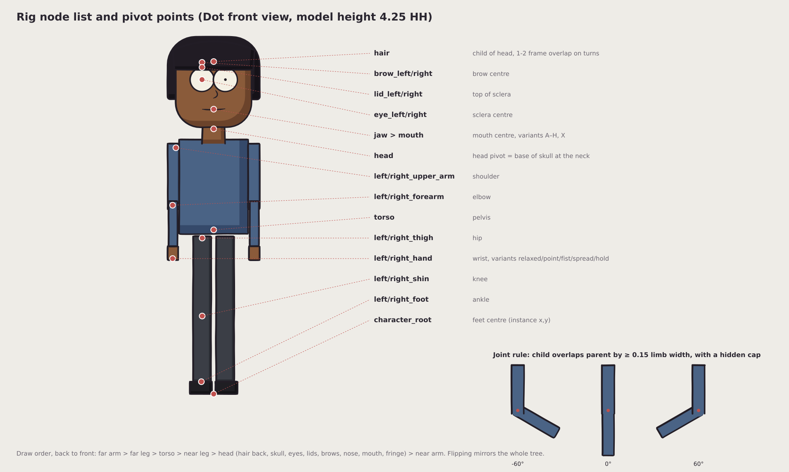

| Node | Pivot (x, y HH) | Notes |
|---|---|---|
| `character_root` | 0, 4.25 | feet centre = the instance's bottom-centre x,y |
| `torso` | 0, 2.25 | pelvis; children: arms, head |
| `head` | 0, 1.02 | base of skull. Head rotation is limited to ±12° (more needs a new view drawing) |
| `hair` | 0, 0.20 | child of head; lags 2 frames on turns |
| `eye_left/right` | ∓0.142, 0.42 | sclera centre; contains `pupil_*` and `lid_*` |
| `lid_left/right` | ∓0.142, 0.27 | top of sclera |
| `brow_left/right` | ∓0.142, 0.21 | |
| `nose` | 0.02, 0.58 | |
| `jaw` → `mouth` | 0, 0.78 | mouth variants A–H, X plus emotion mouths. `jaw` translates y by `jawDropOfMouthWidth` |
| `left/right_upper_arm` | ∓0.46, 1.25 | shoulder |
| `left/right_forearm` | ∓0.50, 1.95 | elbow |
| `left/right_hand` | ∓0.50, 2.60 | wrist; variants |
| `left/right_thigh` | ∓0.14, 2.35 | hip |
| `left/right_shin` | ∓0.14, 3.30 | knee |
| `left/right_foot` | ∓0.15, 4.10 | ankle; the foot is locked to the floor during contact |

**Joint rule.** Every child segment overlaps its parent by ≥ 0.15 × the limb width, with a hidden round cap (diameter = limb width) at the pivot. Rotating the joint ±60° must never show the background. That's the Oona shoulder bug.

**Draw order, back to front:** far arm → far leg → torso → near leg → head (hair back, skull, ears, eyes, lids, brows, nose, mouth, fringe/hair front) → near arm.

---

## 4. The leads

These three replace the Quark family as the reference cast. Shape language: **rectangle, capsule/inverted triangle, pear/circle.**

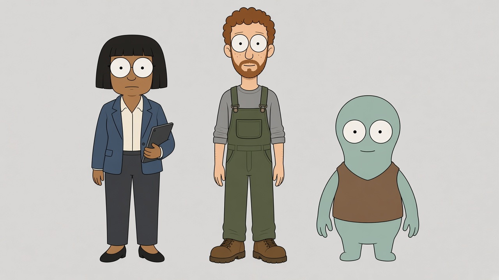

### Dot Lind
- **One line:** a 45-year-old claims adjuster for the municipal Office of Anomalous Losses. She's competent, unimpressed, and the last sane adult on the street.
- **Rationale:** her rectangle head, boxy blazer and blunt bob all say stability and dryness. She's the deadpan anchor every scene cuts back to. The low-chroma slate and cream let her sit in any palette.
- **Proportions:** 4.25 HH, head W 0.92.
- **Palette:** skin `#8A5B3A`/`#6B432B`, hair `#211C24`/`#151218` (highlight `#3A3342`), blazer `#4A6385`/`#35496A`, shirt `#EDE3CC`/`#CDBE9E`, trousers `#3B3E46`/`#2A2C33`, shoes `#1F1E23`, tablet `#2C3038` (screen highlight `#6F7B8C`).
- **Signature shapes:** the straight-cut fringe line and the squared shoulders. **Prop:** a slim tablet.
- **Acting:** Dot moves least. She has the longest holds of the cast, takes are small (10–15% anticipation) and she leans on lids.

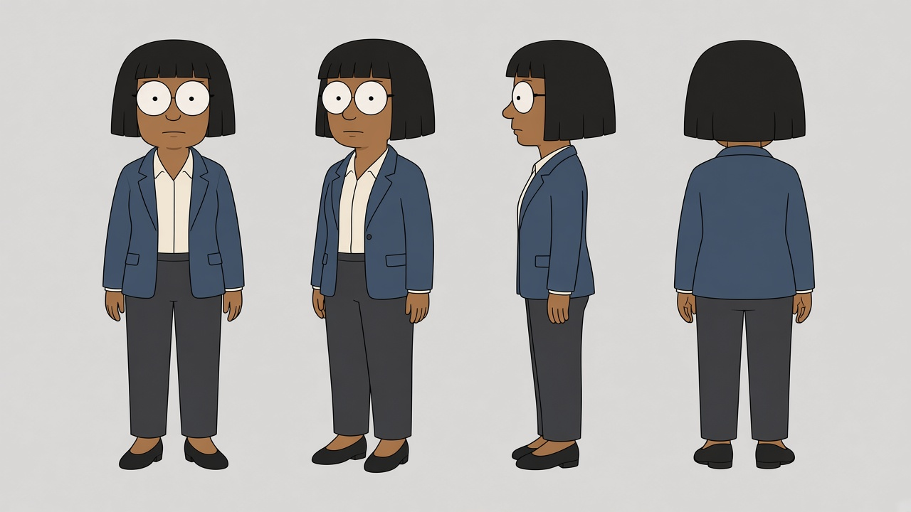
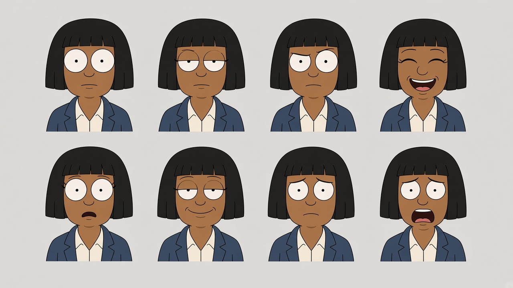
*Top row, left to right: neutral, deadpan, annoyed, laughing. Bottom row: scared, smug, sad, shouting (but see the correction below).*

### Teo Lind
- **One line:** Dot's younger brother. He runs a repair business for imported off-world appliances out of her garage. He's earnest, overcommitted, and certain that this one is fixable.
- **Rationale:** a tall capsule head on an inverted triangle that stretches upward, with a wiry curly-hair crown. He reads as eager and slightly precarious. The workwear grounds him so he's a tradesman, not a mad scientist.
- **Proportions:** 4.75 HH, head W 0.78.
- **Palette:** skin `#EBC3A0`/`#CC9E7E`, freckles `#C98B66`, hair and beard `#9A4E2C`/`#783A1F`, shirt `#8E9092`/`#707274`, overalls `#66704A`/`#4C5536`, buckles `#B9A46A` (highlight `#E2D3A0`), boots `#7A5233`/`#5B3C24`.
- **Signature shapes:** the curl crown (circles of 0.09–0.12 HH) and the beard mass. **Prop:** a screwdriver in the bib pocket.
- **Acting:** the most physical of the three. He gets smears on fast reaches and is the only lead allowed big takes.

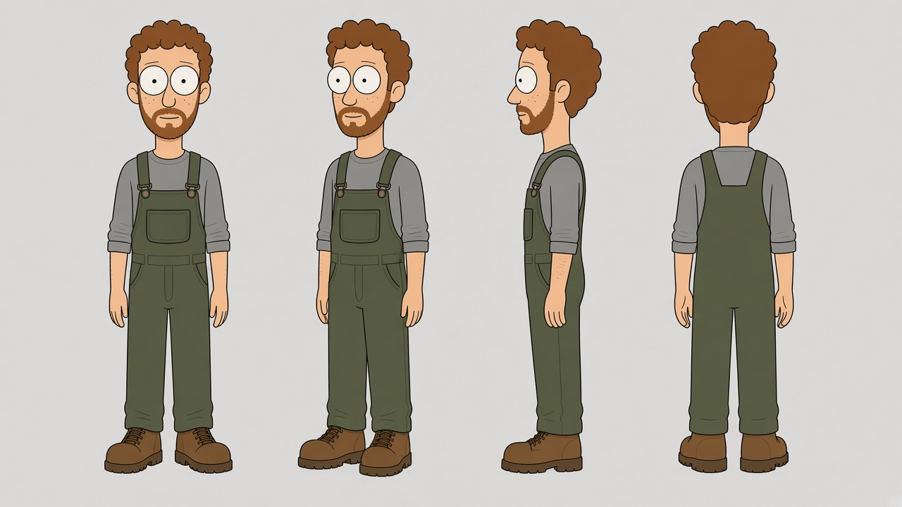
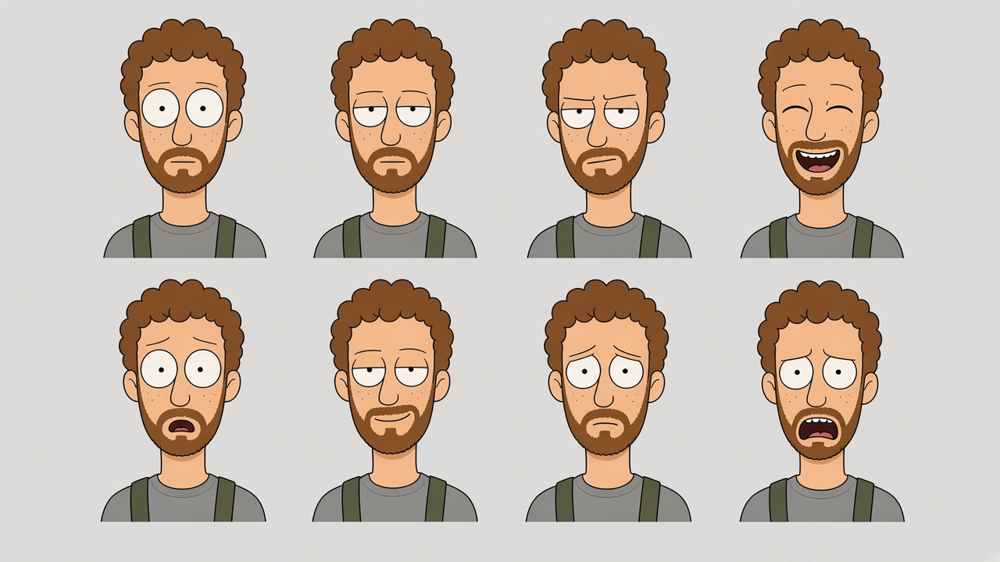

### Gloam
- **One line:** a lodger in Dot's spare room. He's a centuries-old alien bookkeeper of impeccable manners, and nothing surprises him.
- **Rationale:** a pear and a circle, soft and immovable, with no brows. His calm is literally built into the geometry. The sweater vest makes him domestic rather than "alien".
- **Proportions:** 2.0 HH.
- **Palette:** skin `#8AB3A2`/`#6B9282`, vest `#7A5A44`/`#5D4332`, mouth cavity `#33282E`, tongue `#B97C82`.
- **Signature shapes:** the dome-to-neck curve and the hem of the vest.
- **Acting:** minimal and precise. He has the slowest timing (anticipation 6–8 frames), and his gags come from stillness.

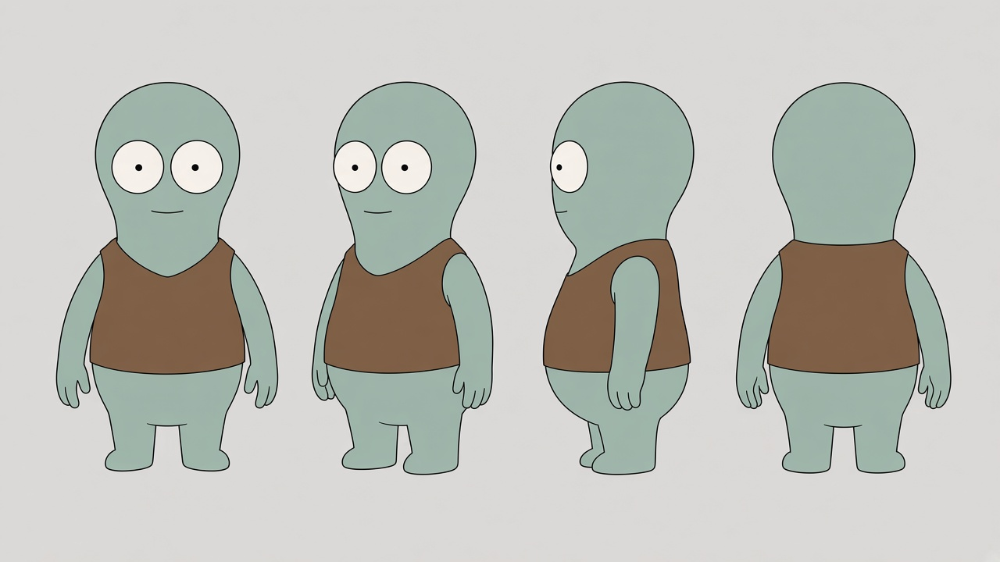
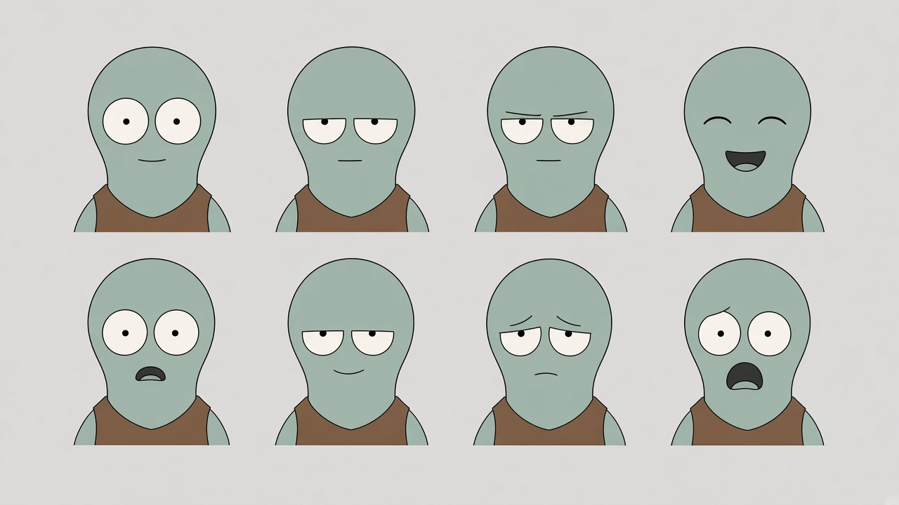

**Shouting correction.** In all three sheets the generator's "shouting" cell reads as fear (brows up). The correct shout is below: brows pressed into a V, lids lowered 20%, pupils focused, and a squared mouth showing the upper teeth.

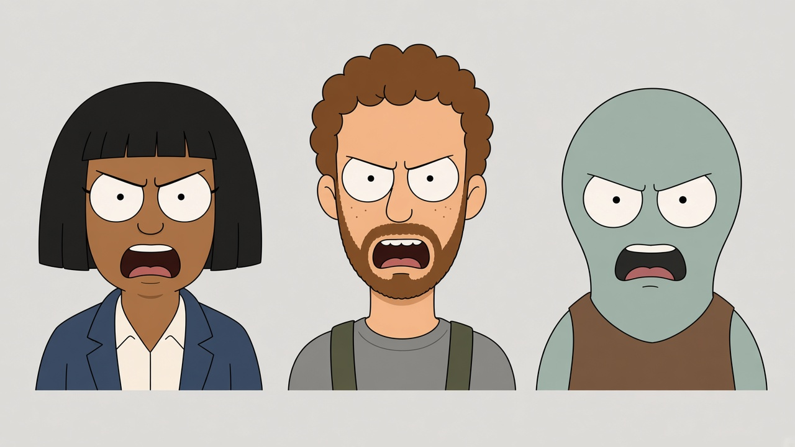

**Expression rules (all leads).**

| Expression | Lid coverage | Brows | Mouth |
|---|---|---|---|
| neutral | 0% | at rest | X |
| deadpan | 45%, flat | at rest | X |
| annoyed | 30%, −12° | −12° | `frown` or a pressed-flat A |
| laughing | closed arcs | +0.03 HH | D with the jaw dropped |
| scared | 0%, pupils 0.6× | +0.04 HH, inner ends up | E |
| smug | 50%, +8° | one brow +8° | `smirk` |
| sad | 18%, +14° | inner ends up | `frown` |
| shouting | 20% | V at 18° | D, squared |

### Viseme sheet: Dot

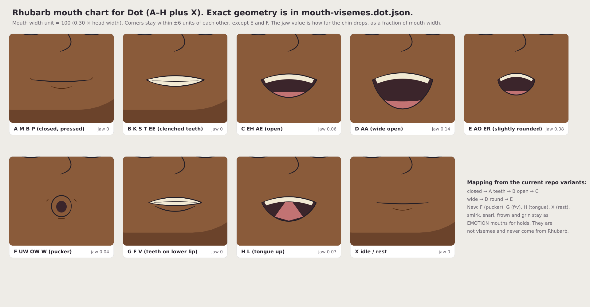

The exact geometry is in **`mouth-visemes.dot.json`**. It's in the repo's shape-tree format, in stage units, with the neutral mouth 40 units wide. It **passes `validateAsset`** as-is (tested). The generated mood sheet `images/dot-visemes-mood.jpg` is **not** authoritative: it drifts off-model and gets G and H wrong.

| Rhubarb | Sounds | Shape | Jaw drop (× mouth width) | Repo variant today |
|---|---|---|---|---|
| A | M B P | lips pressed, corner ticks | 0 | `closed` |
| B | K S T EE, most consonants | lips parted, clenched teeth | 0 | `teeth` |
| C | EH AE | open, upper teeth, tongue low | 0.06 | `open` |
| D | AA | wide open | 0.14 | `wide` |
| E | AO ER | rounded, narrower (0.64 W) | 0.08 | `round` |
| F | UW OW W | tight pucker (0.34 W) | 0.04 | *new* |
| G | F V | upper teeth on lower lip | 0 | *new* |
| H | L | open, tongue tip up behind the teeth | 0.07 | *new* |
| X | silence | relaxed closed (0.88 W) | 0 | *new* (do not reuse A) |

`smirk`, `snarl`, `frown` and `grin` stay as **emotion mouths** for holds. They never come from Rhubarb.

---

## 5. Environment rules

- **Perspective.** Use one-point for interior coverage, like sitcom staging against the back wall. Use two-point for establishing shots and exteriors. The horizon sits at standing-adult eye level, 40–45% up the frame in medium shots. Verticals stay vertical, so no three-point perspective except a single gag shot. Slight fisheye (≤ 3% barrel) is allowed only for establishing shots or a POV gag.
- **Line.** Use `bg` 2.5 px and `bgDetail` 1.5 px in darkened local colour, and `bgFar` 1.0 px. Backgrounds are never inked.
- **Value and saturation.** Day backgrounds sit at L\* 35–85, night backgrounds at L\* 10–45. Background chroma is ≤ 0.08 OKLCH except emissives. Character chroma may go up to 0.15. Apply the value separation rule from §2.
- **Detail budget.** The "staging zone" (central 50% of width × lower 60% of height) stays low-detail, with no small repeated items behind heads. Outside it, allow at most one detail cluster per sixth of the frame. Props get 2–5 interior lines, not 15.
- **Texture.** None: no grain, paper or noise. Shadows in backgrounds use one flat tone with a hard edge.
- **Parallax layers.** Each scene has `layers`: `sky/far` (factor 0.15, `bgFar` line), `mid` (0.4), `main` (1.0, where characters stand) and an optional `fg` overlay (1.3, L −0.15, no line detail). Camera pans move each layer by `pan × factor`. Today the environment is one flat asset (`renderer.js` draws `env.shapes` at 1:1).
- **Rebuilding plates.** The generated plates are **layout and colour targets**. Rebuild them as vector `environment` assets (≤ 500 shapes) using these rules. Don't import the JPGs, because the validator rejects external images anyway.

---

## 6. Locations (original)

### Garage lab: "Lind Repair" (Teo's workshop in Dot's garage)
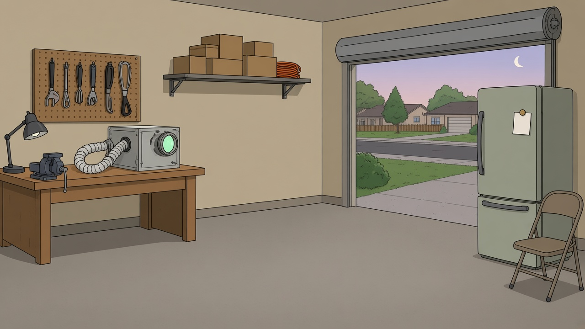
- **What it is:** a suburban double garage that half-belongs to a repair business. It should feel tidy-but-losing.
- **Key props:**
  - a workbench with a vice and an arm lamp
  - the hero prop: a disassembled boxy off-world appliance with a ribbed hose and a pale-green porthole (emissive `#A6E8B0`)
  - a pegboard holding six or seven tools
  - one shelf of plain boxes
  - an orange extension cord, an old fridge and a folding chair
  - the half-open roll-up door showing the street and a lilac sky with a faint second moon
- **Palette:** `garage_lab` (wall `#D2BF9C`, concrete `#9A948C`, bench `#9C6C46`, fridge `#9DAA95`, cord `#D27A3E`, outside sky `#C8B7D2`). Light comes from 20°, through the door.
- **Staging:** characters stand on the open concrete in the centre, and the door works as a natural frame-within-a-frame.

### Alien market: "the Glasshouse"
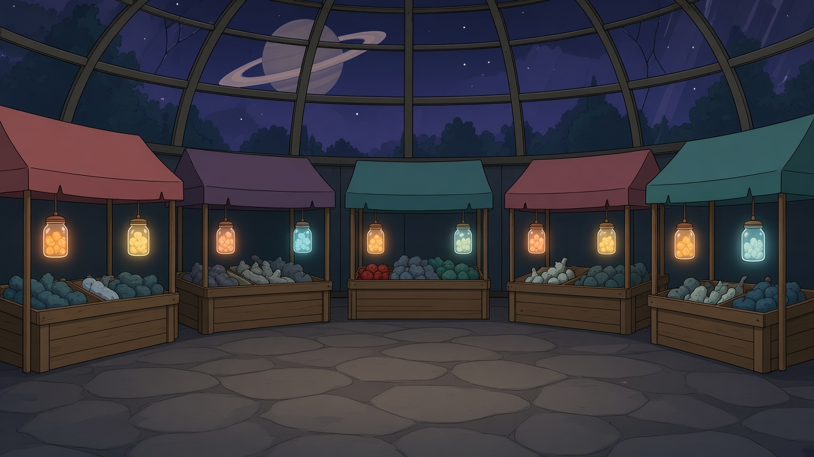
- **What it is:** a night market in an old greenhouse dome, with a few cracked panes.
- **Key props:** five simple stalls with flat awnings (no fringe), crates of knobbly blue tubers and pale pods, glowing hanging jars, flagstones, and a large pale ringed planet beyond the glass.
- **Palette:** `market_neon`. The surroundings are dark and low-chroma, and **only the jars are bright** (amber `#FFC46B`, cyan `#7FE6E0`). Those jars drive the rim light on characters.
- **Weak spot:** the plate's stalls sit on a flat arc rather than true two-point. When rebuilding, set a vanishing point at x = 1480 on the horizon at y = 0.4H, so the aisle recedes right.

### Suburban kitchen: Dot's kitchen
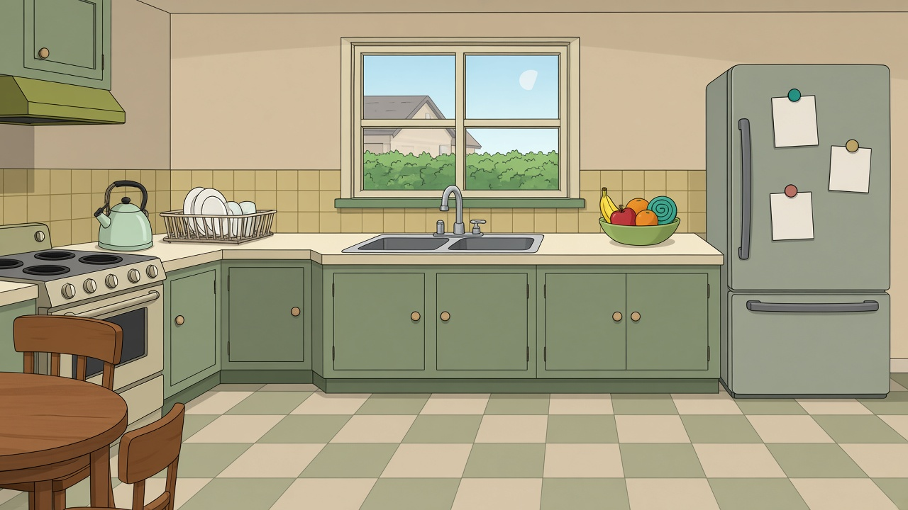
- **What it is:** a modest 1990s kitchen, the sitcom's home base.
- **Key props:** sage cabinets, cream laminate counters, a dated stove, a kettle, a dish rack, a fruit bowl with one teal spiral fruit (the only "alien" note), a fridge with blank notes, a round wooden table with chairs, and a window over the sink (neighbour's house, hedge, faint second moon).
- **Palette:** `kitchen_day`. The wall is raised to `#E0D3B4` so Gloam (`#8AB3A2`) clears the value-separation rule. Light comes from 135°, through the window.
- **Staging:** one-point coverage with the table at screen right for sit-down beats.

---

## 7. Animation timing (24 fps master)

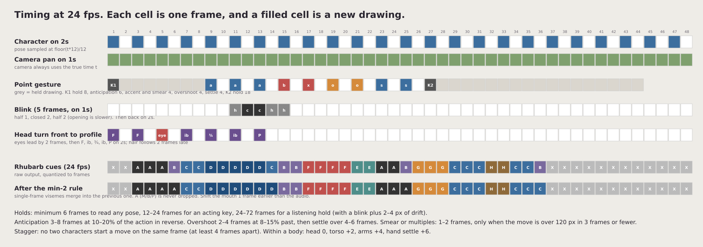

- **Frame rate.** Run the timeline at **24 fps** and export at 24.000 CFR. A 25 fps deliverable for EU broadcast is an export option that keeps the same drawing cadence.
- **On 2s by default.** Character transforms and drawings are sampled at `tq = floor(t·12)/12`. The camera, and anything riding the camera, uses `t` (1s).
- **When to go on 1s:**
  - any part moving more than 24 px per frame
  - a character during a camera pan (otherwise they strobe against the background)
  - takes
  - the 2 frames around a smear
  - blinks
- **Holds.** Any readable pose holds at least 6 frames. Acting keys hold 12–24 frames, and listening holds run 24–72. Moving holds drift 2–4 px with ease plus one breath (torso scaleY 1.000 → 1.012 over 48 frames). Never put a sine idle on a joint.
- **Anticipation:** 3–8 frames at 10–20% of the action, in reverse (Dot 3–4, Teo 4–6, Gloam 6–8).
- **Overshoot:** 2–4 frames at 8–15% past the key, then settle over 4–6 frames.
- **Easing.** Slow in and out on all character keys. `linear` is only for mechanical movement and camera trucks. The repo's `easing:"hold"` is the default between acting keys.
- **Smears and multiples.** Use one only when a move covers more than 120 px in 3 frames or fewer. Either 1 smear drawing (stretched 1.5–2.5× along the motion) or 2–3 opaque multiples, for at most 2 frames, once per action. Never on Gloam.
- **Blinks.** 5 frames on 1s: half 1, closed 2, half 2. They're seeded per instance at a 2.5–6 s random interval, with a double blink 1 time in 6. Add a motivated blink on head turns and new thoughts. **Never blink on a punchline hold, and never sync blinks across characters.**
- **Head turns.** The eyes lead by 2 frames. Then front, in-between, three-quarter, in-between, profile on 2s (10 frames total). The hair lags 2 frames, and the body follows 2–4 frames after the head.
- **Lip sync.** Use Rhubarb Lip Sync with `--extendedShapes GHX`.
  - Quantize cues to 24 fps.
  - **Hold every viseme for at least 2 frames.** Merge any 1-frame cue into the previous one.
  - **Never drop A** (M/B/P): force 2 frames, borrowing from a neighbour.
  - Switch to X after 6 frames of silence.
  - Shift the mouth **1 frame earlier** than the audio.
  - On a stressed syllable the head may dip ≤ 2°, at most once per 12 frames. That replaces the constant `talk·sin(t·9)` bob.
- **Acting beats.** Allow at most one major gesture per sentence, and listeners hold. Two characters never start a move on the same frame (offset ≥ 4 frames). Within a body, the head starts at frame 0, the torso at +2, the arms at +4 and the hand settles at +6. Feet stay locked on contact, with zero slide during a plant.
- **Camera.** Cuts are the default (average shot 3–5 s in dialogue). Cut on action. Pans must be motivated by following action, with ease in and out over 8–12 frames. **No unmotivated zooms.** Push-ins are ≤ 5% scale per second and only for a reveal or a beat. A Dutch angle is ≤ 8° and only for one gag. The `low`/`high` shear "perspectives" are banned.

---

## 8. Pro TV vs amateur puppet: checklist

| Puppet tell | Where it comes from in this repo | Fix |
|---|---|---|
| Parts slide or detach at joints | no overlap or caps at shoulders and elbows | joint rule: ≥ 0.15 limb-width overlap plus a hidden cap; ±60° test |
| Everything moves at once | sine idles on arms and head, talk-driven head and arm wobble (`renderer.js:76,78,82,93`) | delete them; one gesture per sentence; offsets head 0 / torso +2 / arms +4 / hand +6 |
| No holds | continuous interpolation, no `hold` keys | holds of at least 6 frames; acting keys 12–24 frames; moving holds |
| Linear or smoothstep mush | smoothstep on every channel, every frame | key on 2s with authored anticipation and overshoot; `hold` between keys |
| Symmetric twinning | both arms or brows mirrored by `sign` | asymmetry rule: never mirror both sides on the same frame; offset 2–4 frames and vary amplitude 60–100% |
| Mouth flapping on 1s | amplitude or text-letter mouth changing every frame | Rhubarb, at least 2-frame holds, A never dropped, X at rest |
| Floaty feet | `walk` bobs y while x keyframes slide | contact-locked feet; walk cycles of 12 drawings on 2s per step pair; the root moves only during the passing position |
| Perfect vector lines | paths never wobble, no taper | `line-engine` taper plus seeded wobble on all shapes; screen-space width |
| Even lighting | no shadow side, background as bright as the characters | offset-mask shadow per part, scene light angle, value separation ≥ 12 L\* |
| Geometric "turnarounds" | `scale(0.7,1)` profile, skewed three-quarter | drawn view variants with an in-between |
| Synced robotic blinks | `sin(t·1.7) > 0.995` on scene time | seeded per-instance schedule |
| Background competes | backgrounds inked in 3–6 px black | `bg` 2.5/1.5 px in darkened local colour, compressed values |
| Camera shear and floaty zooms | perspective transforms, `zoomEnd` everywhere | cuts first, motivated pans, ≤ 5%/s push-ins |

---

## 9. Reference image reliability

| Image | Status | Notes |
|---|---|---|
| `cast-lineup-front.jpg` | **Design lock (front)** | Costume, hair, colour intent and relative heights. It has no cel shadows (the generator ignored that instruction), so take shadows from §2. |
| `dot-turnaround.jpg` | **Usable model reference, with caveats** | Consistent across views. The generator added a glasses-arm line from the eye to the hair in the profile and front views. **Dot does not wear glasses, so ignore it.** The three-quarter view is an approximation, so use the §3 rotation rules over it. |
| `teo-turnaround.jpg` | **Usable model reference** | The most consistent sheet. The three-quarter face is a shifted front, not a true construction. |
| `gloam-turnaround.jpg` | **Usable model reference** | Consistent. |
| `dot-expressions.jpg` | Expression reference | Good. The "scared" cell doesn't shrink the pupils, and "shouting" reads as fear (see the fix). |
| `teo-expressions.jpg` | **Mood only for eyes** | Eye size changes between cells (neutral is larger). Expressions are OK, but use the eye construction for size. |
| `gloam-expressions.jpg` | Expression reference | Good. "Shouting" reads as fear (see the fix). |
| `cast-expression-shouting.jpg` | Expression reference | The correct anger read for all three. |
| `dot-visemes-mood.jpg` | **Mood only, not authoritative** | Off-model head, heavy lids, wrong G and H. Use the SVG and JSON. |
| `keyart-kitchen-style-frame.jpg` | **Mood / style frame** | Gloam looks at the camera instead of the paper, and the paper has greeked lines. The look and tone are right. |
| `bg-*.jpg` | **Layout and colour targets** | Rebuild as vector. The kitchen is closest to spec. The garage has slight gradients on objects. The market lacks true two-point perspective. |
| All `*.svg` | **Authoritative geometry and numbers** | Drawn in code from `palettes.json` and `line-engine.mjs`. |
| `rejected/` | Kept for the record | Lineup v1 (too realistic), garage v1 (rendered and textured), market v1 (busy, ornate), generated line/colour demo (night grade turned the skin purple, which is exactly the mistake to avoid). |

---

## 10. Implementation notes mapped to the repo

1. **Validator first (`src/model.js validateShape`).** Unknown fields are discarded, so nothing below survives a save until it's whitelisted.
   - Add `line` (enum of the §1 classes), `taper: [start, end]`, `seed` (int), `shadow` (bool) and `shadowK` (0–0.4).
   - Add scene fields `palette` (key into `palettes.json`), `lightAngleDeg`, `layers[]` with `parallax`, and an instance field `onOnes` (bool) plus blink `seed`.
   - Add the roles `lid`, `jaw`, `hair` and `hand` to `roles`.
2. **Stroke engine (`src/renderer.js drawShape`, `:130–200`).**
   - Replace `ctx.stroke()` with a filled outline from `line-engine.mjs`: `styledStroke(points, palettes.line.classes[s.line], {closed, seed, light})`.
   - Paths need flattening. Use `svg-path-properties` (MIT) or a small SVG-path flattener, and cache the result per `(path, seed, scale bucket)`.
   - Delete `roughEllipse`/`roughRect`, which are scale-dependent and skip paths. Gate the whole engine on the episode style, not the `/squiggly|hand.drawn|wicked/` regex (`:226`).
   - Default class: `strokeWidth ≥ 3` → `contour`, otherwise `interior`. For environment assets, use `bg`/`bgDetail`.
3. **Screen-space width.** Pass `instanceScale·zoom` into `drawShape` through `acting` and apply the §1 formula.
4. **Shadows (`drawShape`, after the fill).** If `s.shadow !== false` and the shape is a closed character part, apply the offset-mask recipe with `scene.lightAngleDeg` (mirror the angle when `p.flip`). Rim works the same way in `market_neon` and `exterior_night`.
5. **Time quantization (`renderFrame`).** `const tq = p.onOnes ? t : Math.floor(t*12)/12`. Use `tq` for `interpolate`, `poseAt`, beats and mouths, and `t` for the camera. Remove the sine idles and talk wobble (`:76,78,82,93`) and `motionOffset`'s idle sine (`pose.js:52`).
6. **Blinks (`:108`).** Replace the scene-time sine with a precomputed per-instance blink list (seeded with `fnv1a(instance.id)`), using the 5-frame on-1s shape (scaleY 1 → 0.5 → 0.1 → 0.1 → 0.5 → 1, or better, a `lid` variant).
7. **Lip sync (`pose.js speechMouth`).**
   - In `electron/speech.mjs`, after TTS, run Rhubarb on the WAV: `rhubarb -f json --extendedShapes GHX -d dialogue.txt line.wav`. Store the cues on the dialogue line as `visemes: [{t, v}]`.
   - In the renderer, look up the cue at `tq − 1/24` and apply the min-2-frame and keep-A rules at load time.
   - Rename mouth variants to `A`–`H`, `X`. `mouth-visemes.dot.json` is a drop-in for Dot.
   - Keep `speechMouth` only as a fallback when Rhubarb is missing.
8. **Views (`:270–282`).** Remove the skew and squash for any asset that has view variants. Select `head`/`torso` variants by `p.view`, and treat a missing variant as a review error.
9. **Camera (`:231–232`).** Remove the `perspective` shear. Clamp `zoomEnd` so the speed stays ≤ 5%/s unless the shot has `motivated:true`.
10. **Parallax.** Draw environment `layers` with `translate(-(camX)·parallax)` before `main`.
11. **1080p deterministic export (`app.js:696`).**
    - Replace `captureStream(30)` plus MediaRecorder with frame stepping: for `n` in `0..N`, call `renderFrame(offscreen1920x1080, ep, n/24)`. Encode with WebCodecs `VideoEncoder` (H.264 High, 16 Mbps, 1920×1080, 24 fps), or send PNG frames to an ffmpeg child process in the main process.
    - Mux with the mixed audio rendered offline (`OfflineAudioContext`).
    - `renderFrame` already scales by `canvas.width/1280`, so only the canvas size changes.
12. **Contact shadow (`:268`)** comes from `scene.contactShadow`.
13. **Cast and IP cleanup (`src/family.js`, `src/standards.js`, `docs/STANDARDS.md`).**
    - Retire or redesign Oona and Pip, and replace the reference cast with Dot, Teo and Gloam.
    - Rename and redesign `portal` into something without a ring or swirl (e.g. a "seam": a vertical tear with layered offset edges).
    - Update the director's standard catalogue so the LLM stops being offered those designs.

---

## 11. Acceptance checklist (test a 1080p export)

Each line is pass/fail. Measured items name the tool.

**Format and timing**
- [ ] `ffprobe`: 1920×1080, 24.000 fps CFR, frame count = round(duration × 24) ± 0, square pixels, no dropped frames.
- [ ] Static-camera shot: in the character bbox, pixel differences between frames occur **only on even frame indices**, except shots flagged `onOnes`, blinks and smears.
- [ ] A held drawing with no boil is **pixel-identical** (diff = 0) across its hold, so the wobble doesn't swim.
- [ ] No sine idle: while a character holds a key, its joint transforms are constant (log check).

**Line**
- [ ] Medium shot: the character contour cross-section measures 4.0 ± 0.5 px, interior lines 2.75 ± 0.4 px, background contours 2.5 ± 0.4 px, and background lines are never `#221D26`.
- [ ] Open interior strokes visibly taper (end width ≤ 50% of the middle).
- [ ] Close-up vs wide: the contour stays within 0.8–1.25× of spec.

**Colour and value**
- [ ] Every character part has exactly one shadow tone, on the side away from `lightAngleDeg`. It flips with `flip:true`.
- [ ] No highlight on eyes. Highlights appear only on the allowed parts.
- [ ] Value separation: silhouette mean L\* vs surrounding background mean L\* ≥ 12 on 5 sampled frames per scene.
- [ ] No rim light in day scenes. In neon scenes the rim is 2.5 ± 0.5 px on the source side.

**Rig and drawing**
- [ ] Every joint at ±60° shows no background gap (render the pose extremes from `review_production`).
- [ ] No `scale(0.7,1)`/skew fake views on leads. Profile and three-quarter drawings exist for any shot that uses them.
- [ ] Silhouette test at 96 px passes for every key pose (manual review).
- [ ] Pupils are 0.11 × the sclera diameter (± 0.02). The scleras touch.

**Performance**
- [ ] Lip sync: no viseme shown for fewer than 2 frames. Every M/B/P in the transcript lands on an A frame within ±1 frame. X during silences longer than 6 frames.
- [ ] Blinks: 5 frames each, per-character intervals 2.5–6 s, never simultaneous across characters, none during a punchline hold.
- [ ] No two characters start a move on the same frame. Planted feet slide by 0 px.
- [ ] Every pose is held for at least 6 frames. Every acting key has anticipation and overshoot within §7 ranges.

**Camera and content**
- [ ] No camera shear transforms. Zoom speed ≤ 5%/s unless the shot is marked `motivated`.
- [ ] No text artefacts in the picture except intended captions. Captions are off in the master.
- [ ] IP check: no character, prop or location matches a protected design (no grey spiky-haired scientist in a lab coat with a nervous boy sidekick, no green swirl portal, no flying-saucer car, no recognizable house or citadel layouts).
- [ ] SFW: every frame.

---

*Regenerate the SVGs and `mouth-visemes.dot.json` with `node src/make-svgs.mjs` after changing `palettes.json` (rebuilt by `python3 src/build_palettes.py`). PNG previews of every SVG are in `images/svg-previews/`.*
